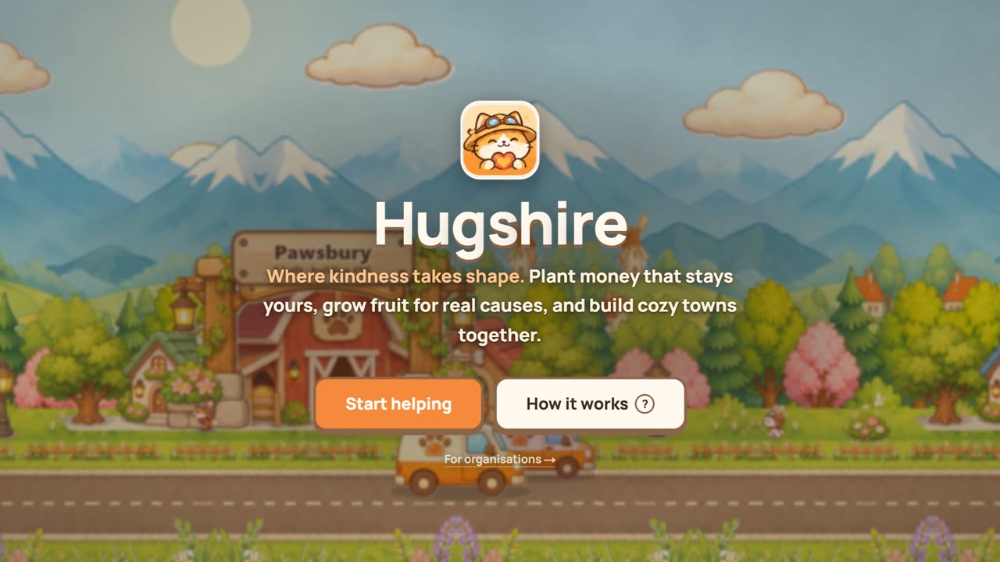
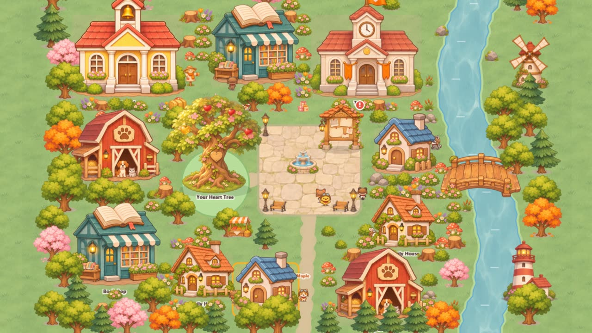
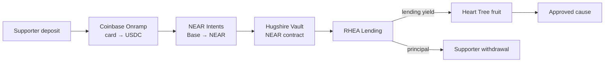
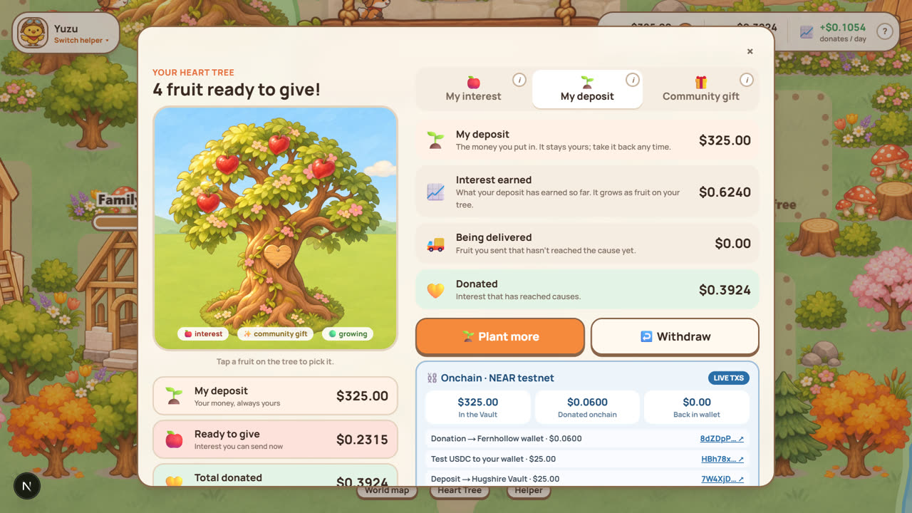
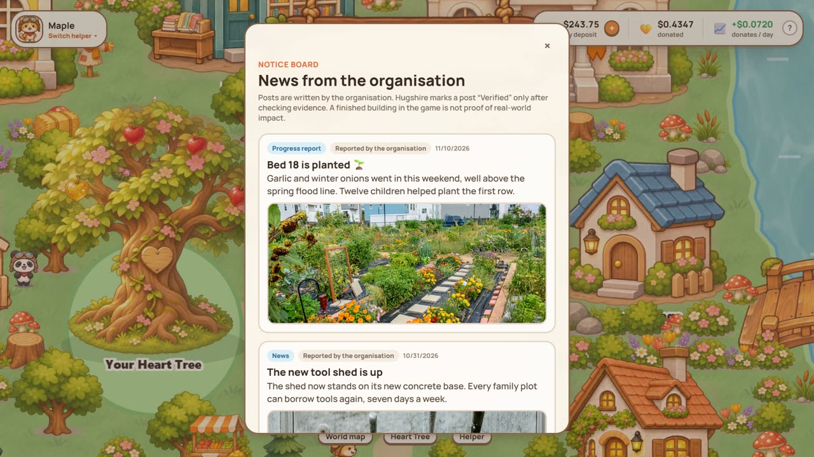
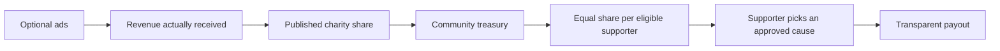
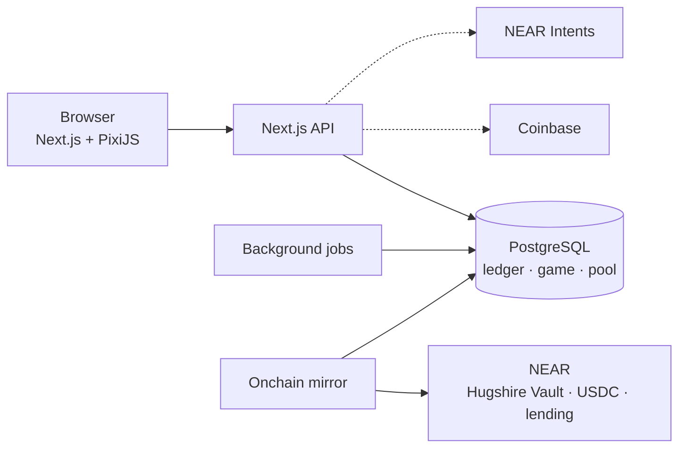

# Hugshire

**Where kindness takes shape.**

Hugshire is a cozy, cooperative town-building game that turns lending yield into support for real causes. Supporters plant a deposit. The yield it earns grows as fruit on their Heart Tree and goes to the charities they choose. Meanwhile, they explore cause towns, build them together with other players, and follow each organisation's real-world updates.

The deposit stays attributable to the supporter and can be requested back at any time. Only the yield supports causes. Yield is variable, and withdrawals are subject to lending risk, liquidity and provider fees.

| | |
|---|---|
| **Play the demo** | https://hugshire.site/ |
| **Watch the trailer** | https://x.com/hugshire_fun/status/2121642297746198702 |
| **Source code** | https://github.com/kamping900-sys/hugshire |
| **Onchain proof** | [NEAR testnet transactions](#onchain-proof-near-testnet) |



---

## Why does doing good feel so hard?

People want to help. The way we ask them to help has friction built in.

1. **Giving means giving something up.** A donation is money gone for good, money a household may need later. For many people that is the deciding barrier.
2. **Asking wears people out.** Charities need ongoing support, but repeated appeals to the same people discourage the very supporters they rely on.
3. **The experience ends at checkout.** Most donations are a single transaction, with little reason to come back, take part, or see shared progress.
4. **Money and outcomes live apart.** Supporters want to know how funds are used, yet financial records and real-world impact updates usually sit in separate, disconnected places.
5. **Support is concentrated.** Charitable revenue can grow even while the number of people giving shrinks, which leaves organisations depending on fewer donors.

### What the research says

| Finding | Population | Source |
|---|---|---|
| **41%** said they cannot afford to donate | U.S. adults who had not donated in the past 12 months | YouGov, Oct 2026 |
| **48%** said feeling pressured or guilted into giving would discourage them | U.S. adults | YouGov, Oct 2026 |
| **40%** said too many requests or follow-ups would discourage them | U.S. adults | YouGov, Oct 2026 |
| **43%** said not knowing how their money will be used would discourage them | U.S. adults | YouGov, Oct 2026 |
| **39%** said clear evidence of how donations are used would encourage future giving | U.S. adults | YouGov, Oct 2026 |
| Dollars raised **+5.0%**, number of donors **−3.6%** (2025 vs 2024) | U.S. nonprofits in the FEP dataset | Fundraising Effectiveness Project |
| Countries where over 80% feel a strong local belonging give **nearly 3×** more | 60,000+ people in 105 countries | CAF World Giving Report 2026 |

**Sources:**
- YouGov: online survey of 1,291 U.S. adults, August 20–21, 2026. [Article](https://yougov.com/en-us/articles/55814-why-americans-donate-to-charity-and-why-they-dont).
- Fundraising Effectiveness Project: [AFP release](https://afpglobal.org/news/fundraising-effectiveness-project-reports-strongest-revenue-growth-five-years-even-fewer). Overall giving grew while participation fell.
- Charities Aid Foundation: [press release](https://www.cafonline.org/home/about-us/press-office/world-giving-report-reveals-factors-that-increase-generosity-to-good-causes), June 2026.

Detail and interpretation are in [Research and evidence](docs/RESEARCH_AND_EVIDENCE.md).

---

## Introducing Hugshire

Hugshire answers each barrier with one of three connected systems.

| Barrier | Hugshire's answer |
|---|---|
| "I can't afford to give money away" | **Yield-powered giving.** Your deposit stays yours; only the yield it earns supports causes |
| "Too many asks" | Support is **continuous and automatic** (daily auto-send), not a fresh appeal each time |
| "It ends at checkout" | **Cooperative towns.** Play, build and come back to a world you share with other supporters |
| "I don't know where it goes" | **Notice Board updates** next to **verifiable onchain transfers** |
| "Support is concentrated" | A **Community Heart Pool** turns optional ad revenue into equal shares for every eligible supporter |

### 1. Yield-powered giving

- **Deposit:** a supporter deposits into the **Hugshire Vault**, a Rust smart contract on NEAR, which lends through **RHEA**.
- **Yield as fruit:** the variable yield appears as Heart Fruit on their tree.
- **Delivery:** they harvest the fruit and send it to an approved cause, or authorise daily auto-delivery.
- **Principal:** it stays attributable to the supporter in the Vault and can be requested back.

### 2. Cooperative community participation

- **Towns:** every cause has its own shared town.
- **Play:** players pick an animal helper, explore towns on a world map, and chop Wood in a timing mini-game.
- **Build:** they put that Wood into community buildings and watch the town grow with everyone's help.

Wood is a virtual game resource. It is kept completely separate from money and never converts into it.

### 3. Community-directed funding

- **Ads:** after a game, players can choose to watch an ad.
- **The pool:** a disclosed share of advertising revenue that has actually been received funds the **Community Heart Pool**.
- **Equal split:** the pool is split **equally** between eligible supporters, regardless of deposit size or how many ads anyone watched. Each supporter directs their share to an approved cause.

**Why the three systems belong together:** yield gives organisations a steady base of support that doesn't depend on repeated appeals. The game gives supporters a reason to return and take part. Shared ad funding widens who can contribute. Through the Notice Board and onchain records, supporters can always see where it goes.



---

## How it works

1. Sign in with email and choose an animal helper.
2. Choose the cause your helper will support.
3. Plant a deposit.
4. The Vault supplies the funds to the lending market.
5. Variable lending yield accrues.
6. Ripe yield appears as Heart Fruit on your tree.
7. Harvest it and send it to an approved cause, or let authorised auto-delivery do it daily.
8. Explore cause towns and help build them with Wood from the mini-game.
9. Optionally watch an ad that can add to the shared Community Heart Pool.
10. Follow organisation updates on the Notice Board, and request your deposit back whenever you need it.



**Which parts run where:**
- **Running on NEAR testnet today:** the Vault deposit, supply to lending, donation to a cause's wallet, withdrawal to the supporter's wallet, and treasury payouts. These use test USDC and a RHEA-compatible lending contract.
- **Integrated, awaiting mainnet:** Coinbase Onramp/Offramp and NEAR Intents. Their adapters are implemented and verified read-only against the live services; they run in mainnet mode once the accounts and approvals are in place.

### Why Coinbase Onramp and Offramp

Getting money in and out costs supporters as little as possible.

- **Zero-fee USDC:** Coinbase offers [zero-fee onramping and offramping for USDC](https://www.coinbase.com/developer-platform/discover/launches/zero-fee-usdc) (buying or selling USDC with a card or bank account) to qualifying apps, until further notice; availability varies by region. Hugshire is built for this route and will apply for it at launch.
- **USDC from start to finish:** a deposit stays in USDC from checkout to the Vault, so there's no token swap or currency spread inside the route. The one other step, NEAR Intents 1Click from Base to NEAR, costs 0.01% for stablecoin pairs with a partner key.
- **A familiar checkout:** card or Apple Pay, with Coinbase handling identity checks and payment compliance.
- **The supporter's own wallet:** USDC is delivered to the supporter's wallet, and withdrawals cash out to their bank through the Offramp.

<p align="center"></p>

---

## Social impact

Hugshire measures impact in three ways, kept clearly apart.

**1. Financial impact (charitable value transferred)**
- Confirmed payouts to approved causes, and the value transferred.
- The number of causes supported, how support is spread across them, and how much of it recurs.

Today, these transfers run as a NEAR testnet demonstration with test USDC. Real charitable transfers begin with the mainnet launch.

**2. Participation impact (engagement, not dollars)**
- Active and returning supporters.
- Wood contributed, buildings completed, and unique contributors per building.
- Towns visited.

These describe engagement with the platform. They are not charitable dollars or verified social outcomes.

**3. Organisation visibility (stories)**
- Organisations post activity updates, photos, progress reports and evidence on each town's Notice Board.
- Posts are labelled "Reported by the organisation" until Hugshire has checked the evidence.
- The game states plainly that a finished virtual building is not proof of real-world impact.

**The long-term opportunity:** turn one-off charitable transactions into recurring participation and lasting relationships between supporters and organisations. The measurement framework is in [Impact and sustainability](docs/IMPACT_AND_SUSTAINABILITY.md).



---

## Business model

Hugshire is designed to fund its own operations from two revenue streams, both disclosed to users and kept separate from user principal in the ledger.

| Revenue source | How it works | Platform benefit | Charity benefit | Status |
|---|---|---|---|---|
| **Share of lending yield** | A transparent platform share of eligible realised yield | Funds operations and development | The remaining yield goes to the causes supporters choose | **Planned.** Today 100% of distributable yield goes to causes; the platform rate is to be set and disclosed before activation |
| **Advertising** | Received ad revenue is split between platform operations and the Community Heart Pool | Funds hosting, development, support and organisation onboarding | Funds equal Community Pool shares | **Split mechanism built.** The charity share is an admin setting, published before any month is finalised (not yet set). Ads are simulated in the demo |

Ad views are never revenue in themselves. Only revenue the provider has actually paid is allocated, and watching more ads never increases a player's pool share. Unit economics and scenarios are in [Business model](docs/BUSINESS_MODEL.md).

## Financial sustainability

- **Diversified charitable funding:** variable yield on deposits, plus community advertising revenue, instead of relying only on repeated direct appeals.
- **Self-funding operations:** the disclosed platform share of yield and ads pays for development, hosting and support, which aligns the business with long-term participation.
- **Reasons to return:** shared towns, construction milestones, helpers, exploration and organisation stories create more chances to discover and support causes. Wood itself never generates financial yield.
- **Transparent allocation:**
  - Separated ledgers for principal, charitable yield, the pool and platform revenue.
  - Approved cause destinations only.
  - Reconciliation every 10 minutes.
  - Published pool snapshots with a hash.
  - Onchain transfer records.

---

## Community Heart Pool



- **What a share is:** the right to direct a portion of a shared charitable budget, not a personal cash reward.
- **Eligibility:**
  - an active account at least **30 days** old
  - at least a **$10** deposit held for the whole **30-day** holding period
  - a one-person uniqueness check
- **Choosing a cause:** supporters have **14 days**. Otherwise their share follows their default cause, home town or last choice.
- **Audit:** each month's allocation snapshot is published with pseudonyms and a sha256 hash, which anyone can recompute.
- **Treasury:**
  - **Designed for mainnet:** a Sputnik DAO v2 managed in Trezu. Hugshire only proposes payouts and a council approves them (2 approvals).
  - **Running on testnet:** a treasury wallet that pays causes, for example this [payout to Pawsbury](https://testnet.nearblocks.io/txns/EBuY3mraEHzhteFTtfgLc29UMRvmLwbqBmqcaEzXoDAZ). Ad revenue in the demo is simulated.

---

## Why NEAR: what it does for Hugshire

**A programmable charitable Vault.** The Hugshire Vault (`contracts/vault`, Rust and near-sdk) enforces the rules onchain:
- **Accounting:** share-based, with principal attributed per supporter, so lending gains and losses are shared fairly.
- **Withdrawals:** only the owner can withdraw, and only to themselves.
- **Destinations:** yield can go only to **approved** cause accounts.
- **Supporter control:** supporters set their own donation policy. Automated delivery is capped by the supporter's signed grant (amount, interval, expiry).
- **Safety:** one operation per supporter per minute, withdrawal pauses capped at 72 hours, and ownership that changes in two steps.

**NEAR Intents 1Click** carries USDC from Base, where Coinbase delivers it, to NEAR in one step. Supporters never handle a bridge themselves.

**RHEA lending.** The Vault supplies USDC to RHEA (`contract.main.burrow.near`) and reads its position to price shares. On testnet it works against a RHEA-compatible lending contract with the same interface.

**Verifiable money movement.** Every financial action is a NEAR transaction anyone can inspect (see [Onchain proof](#onchain-proof-near-testnet)).

**A hybrid game architecture, by design:**
- **NEAR** handles the money.
- **The game server** owns the game rules and virtual Wood, judging every mini-game round.
- **PixiJS** renders the world.
- **PostgreSQL** keeps the application state and a double-entry ledger.

Money and Wood never share an account.

---

## Technical implementation

| Layer | Technology |
|---|---|
| App | Next.js 16, React 19, TypeScript, Tailwind CSS v4 |
| Game | PixiJS 8; Web Audio for sound |
| Data | PostgreSQL with Drizzle ORM (45 tables, migrations run on start) |
| Contracts | Rust and near-sdk 5: Hugshire Vault, test USDC, RHEA-compatible lending pool |
| Integrations | Coinbase Onramp/Offramp, NEAR Intents 1Click, RHEA, Privy (sign-in and wallets), Sputnik DAO |
| Hosting | Railway |



**Engineering highlights:**
- **Contract:** a custom programmable Vault, with an onchain deposit → lending → donation → withdrawal flow on NEAR testnet.
- **Game:** server-validated mini-games (the client sends only raw timings; the server judges every round) and shared construction across all players.
- **Money handling:**
  - Financial state machines and an integer-based double-entry ledger.
  - Idempotent transactions and automated reconciliation.
  - Separate economies for charity money and virtual Wood.
- **Background jobs:** deposits, yield snapshots, deliveries, payouts, the pool cycle and the onchain mirror.

**Tests:**
- **App:** 86 unit tests and 8 browser end-to-end tests.
- **Vault:** 42 contract unit tests and 7 sandbox integration tests.

Full design: [System design](docs/HUGSHIRE_SYSTEM.md) and [Architecture](docs/ARCHITECTURE.md).

---

## What makes Hugshire different

| | Donation platforms | DeFi yield-donation products | Charity engagement apps | Cooperative town builders | **Hugshire** |
|---|---|---|---|---|---|
| Support from yield, principal kept | – | ✓ | – | – | ✓ |
| Cooperative gameplay and shared goals | – | – | some | ✓ | ✓ |
| A town per organisation | – | – | – | – | ✓ |
| Organisation updates in context | some | – | ✓ | – | ✓ |
| Community-directed ad funding, equal shares | – | – | – | – | ✓ |
| Verifiable onchain transfers | – | ✓ | – | – | ✓ |

This compares product categories in general, not specific competitors. More positioning is in [Business model](docs/BUSINESS_MODEL.md#7-positioning).

---

## Hackathon scope and demonstration

| | |
|---|---|
| **Playable demo** | https://hugshire.site/ |
| **Trailer** | https://x.com/hugshire_fun/status/2121642297746198702 |
| **Source** | https://github.com/kamping900-sys/hugshire |

### What judges can test
- **The full game:**
  - Onboarding: sign in, pick a helper, choose a cause, then the test checkout.
  - Town life: the arrival tutorial, towns, the Heart Tree, the Wood mini-game and construction.
  - The rest: the world map, Notice Board, optional ad demo, Community Pool gift, and the withdrawal flow.
- **The money flow:**
  - The public demo runs payments in test mode, with simulated provider steps that are clearly labelled.
  - With onchain mode enabled, each deposit, fruit delivery and withdrawal is also written to NEAR testnet and listed with explorer links in **Heart Tree → My deposit**.

### Onchain proof (NEAR testnet)

These are real NEAR testnet transactions using test USDC. They are not charitable donations of real money.

| Action | Transaction |
|---|---|
| Deposit into the Hugshire Vault | [7wXBF1es…](https://testnet.nearblocks.io/txns/7wXBF1es7kfm8FQyS5H3aBEnCAGdT78iU1nXfFnwVoTd) |
| Donation from the Vault to a cause's wallet (Fernhollow) | [8dZDpPUM…](https://testnet.nearblocks.io/txns/8dZDpPUM5XHG3z11zV6vYR9S8Z7iB3Sc6BqSYb6iWFbg) |
| Withdrawal back to the supporter's wallet | [HK7HQutw…](https://testnet.nearblocks.io/txns/HK7HQutwetrJjbNY1gu6fWbDk61GYjL851bTZwWuTR4R) |
| Community treasury payout to a cause (Pawsbury) | [EBuY3mra…](https://testnet.nearblocks.io/txns/EBuY3mraEHzhteFTtfgLc29UMRvmLwbqBmqcaEzXoDAZ) |

**Vault contract:** [`vault.hugshire-demo-s5q1.testnet`](https://testnet.nearblocks.io/address/vault.hugshire-demo-s5q1.testnet)

### Implementation status

| Area | Status |
|---|---|
| Game and application | **Playable** |
| Vault and money flows on NEAR | **Running on testnet** (test USDC, RHEA-compatible lending) |
| Coinbase, NEAR Intents, RHEA mainnet | **Integrated, awaiting mainnet launch.** Adapters are verified read-only against the live services; launch needs accounts, approvals and the Vault audit |
| Self-custody wallets (Privy) | Server-side sign-in verification built; in-app wallet signing screens are next. On testnet, demo wallets are managed by the server |
| Community treasury | Testnet treasury payouts working; DAO approval workflow designed |
| Advertising | Revenue-sharing mechanism built; ad partnerships are the next step |

---

## Roadmap

1. Launch the mainnet money route after the Vault audit and provider approvals (Coinbase, NEAR Intents, Privy wallets).
2. Onboard more charitable organisations and towns.
3. Establish live advertising partnerships.
4. Activate the platform revenue share at disclosed rates.
5. Deploy the Community Pool DAO approval workflow in Trezu.
6. Deepen cooperative play and shared-world interaction.
7. Publish public impact reports per cause.
8. Add new environments, buildings and community activities.

---

## Quick start

```bash
npm install
```

```bash
cp .env.example .env.local
```

```bash
npm run db:seed
```

```bash
npm run dev
```

Open http://localhost:3200. In test mode, any email works and the sign-in code is filled in for you.

To run the onchain testnet mode locally, use `node scripts/dev-chain.cjs` (port 3400). See [Onchain testnet](docs/ONCHAIN_TESTNET.md).

| Command | Does |
|---|---|
| `npm run dev` | the app, with background jobs running in-process |
| `npm test` | unit tests (embedded Postgres, no setup needed) |
| `npm run test:e2e` | browser tests against the running app |
| `npm run contract:test` | Vault contract tests |
| `npm run verify:live` | read-only checks against RHEA, NEAR Intents, Coinbase and the Vault |

---

## Documentation

| Document | Covers |
|---|---|
| [System design](docs/HUGSHIRE_SYSTEM.md) | everything in one place: architecture, money flows, game, numbers, data model |
| [Business model](docs/BUSINESS_MODEL.md) | revenue streams, allocation, unit economics, configured vs planned |
| [Impact and sustainability](docs/IMPACT_AND_SUSTAINABILITY.md) | impact dimensions, measurement framework, sustainability |
| [Research and evidence](docs/RESEARCH_AND_EVIDENCE.md) | sources, populations, how the research shaped the product |
| [Onchain testnet](docs/ONCHAIN_TESTNET.md) | deployed contracts, transactions, how to run |
| [Architecture](docs/ARCHITECTURE.md) | the live route, custody model, provider verification |
| [Financial model](docs/FINANCIAL_MODEL.md) | ledger, yield, deliveries, payouts, withdrawals, the pool |
| [Vault v2](docs/VAULT_V2.md) | contract design and invariants |
| [Gameplay economy](docs/V4_GAMEPLAY_ECONOMY.md) | Wood, construction, mini-game rules |
| [Security](docs/SECURITY.md) | keys, invariants, controls |
| [Setup guide](docs/SETUP_GUIDE.md) | accounts, keys and commands for deployment |

---

*Hugshire is not a bank. Yield is variable, deposits carry lending and smart-contract risk, and withdrawals are subject to liquidity and provider fees. Testnet transactions use test tokens with no monetary value.*

**Hugshire. Where kindness takes shape.**
