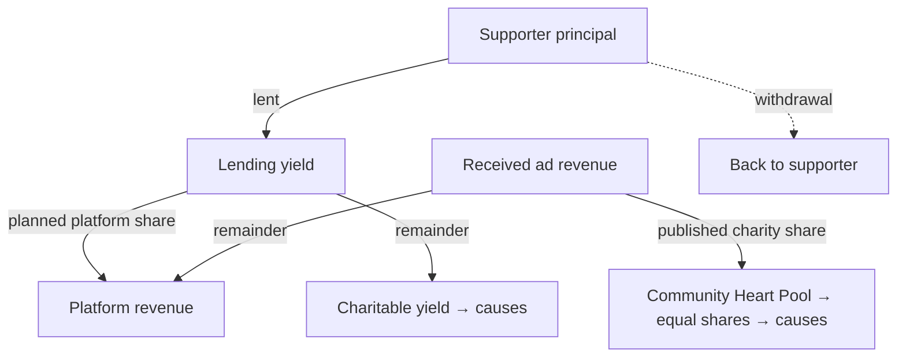

# Hugshire business model

Hugshire is designed as a self-sustaining social-impact platform. It earns its operating revenue from two disclosed sources: a share of lending yield and a share of advertising revenue. Every flow is kept separate from supporters' principal.

This document describes the commercial model, what is **configured in the code today**, and what is **planned and still to be decided**. Every figure in the scenario tables is a labelled assumption, not a forecast or a result.

---

## 1. Configured today vs planned

| Element | In the code today | Planned commercial policy |
|---|---|---|
| Supporter principal | Attributed per supporter (Vault shares and the ledger). Only the owner can withdraw | Unchanged |
| Lending yield | **100% of distributable yield goes to causes** the supporter chooses. Neither the Vault nor the backend takes a platform share | A disclosed **platform share of eligible realised yield**. The rate is **to be determined**, published before activation, and implemented in the ledger and Vault payout logic |
| Advertising revenue | A **revenue split is built**: `budget = floor(received revenue × charity share bps ÷ 10,000)` goes to the Community Heart Pool, and the rest is not allocated to charity | The charity share is **to be determined and published**. The non-charity part funds operations |
| Charity share setting | `poolCharityBps` (admin setting). **Not set yet (0)**, so finalising a pool month is refused until it is published | A published, stable percentage |
| Ad revenue | **Simulated in the demo** ($0.01 per simulated view, labelled). Production ads are switched off (`adsProductionEnabled=false`) | Live ad partnerships. Only revenue the provider has actually paid is counted |
| Provider fees | Coinbase and NEAR Intents fees are passed through, shown to the user and recorded per deposit and withdrawal | Keep them near zero: apply for Coinbase's [zero-fee USDC onramp and offramp](https://www.coinbase.com/developer-platform/discover/launches/zero-fee-usdc) (qualifying apps, until further notice, region-dependent). Use a NEAR Intents partner key (0.01% for stablecoin pairs, versus 0.25% without a key) |

---

## 2. Revenue stream 1: a share of lending yield

**How it works:**
1. Supporters' deposits are lent through the Hugshire Vault to RHEA and earn variable yield.
2. Realised yield is measured from the pool's actual growth, never from a promised rate, and attributed to each supporter by principal × time held.
3. Under the planned model, a disclosed platform share of that yield funds Hugshire's operations. The remainder is charitable yield, delivered as Heart Fruit to the causes each supporter chooses.

**Why it works for each party:**

| Party | Benefit |
|---|---|
| Supporters | Keep their attributable principal (subject to lending risk) and support causes without giving it up |
| Charities | Receive recurring support from yield, independent of new appeals |
| Hugshire | Earns revenue that scales with the value it helps generate, which aligns incentives with long-term deposits |

**Accounting:** the ledger already separates `user:{id}:principal`, `user:{id}:yield_available`, `cause:{id}:yield_pending` and the pool accounts. Activating a platform share would add a `platform:yield_revenue` account, booked in the same journal as each yield allocation, so the split is visible in every snapshot.

**Status:** planned. The rate is to be determined and will be disclosed in the app and documentation before it applies.

## 3. Revenue stream 2: advertising

**How it works:**
1. After a mini-game, players can **choose** to watch an ad. Watching earns no game reward, and skipping costs nothing.
2. The ad provider reports revenue. **Only statements marked as received count**; estimates never do.
3. Each month, received revenue is split by the published charity share:
   - **charity budget** = floor(received × share ÷ 10,000) goes to the Community Heart Pool
   - **platform share** = received − charity budget goes to operations
4. The charity budget is divided **equally** among eligible supporters, each of whom chooses an approved cause (see the [README](../README.md#community-heart-pool)).

**Rules that protect the model:**
- An ad view is not revenue. Allocation only happens after revenue is received and finalised.
- Watching more ads never increases anyone's pool share. Shares are equal per eligible supporter.
- Frequency limits: at most one ad every 3 minutes and 10 a day per player.

**What the platform share funds:** hosting and infrastructure, game development, maintenance, support, onboarding new organisations, and content and community operations.

**Status:** the split, cycle and payout mechanism is built and tested. The charity share is to be set and published. Ad partnerships are the next step.

---

## 4. How money is allocated

These are separate ledgers: principal, charitable yield, Community Pool (`pool:*`), and platform revenue. Virtual Wood has no money accounts at all.

---

## 5. Illustrative unit economics

The formulas are fixed. **Every input below is a hypothetical assumption,** chosen only to show how the model behaves.

**Formulas:**
- Gross yield `Y = D × r`, where D = eligible deposits and r = annual lending yield (variable).
- Platform yield revenue `= Y × p`, where p = platform yield share (to be determined).
- Charitable yield `= Y × (1 − p)`.
- Pool budget `= R × c`, where R = received ad revenue and c = charity share (to be determined).
- Platform ad revenue `= R × (1 − c)`.
- Pool share per eligible supporter `= (R × c) ÷ N`, where N = eligible supporters.

**Assumptions for the table** (hypothetical, not configured): r = 8% a year, p = 10%, c = 50%, and ad revenue and eligible supporters as listed. RHEA's USDC supply rate is variable; it has recently been around 9–11% a year.

| Scenario (per year) | Small | Growing | Scaled |
|---|---|---|---|
| Eligible deposits D | $100,000 | $1,000,000 | $10,000,000 |
| Gross yield (8%) | $8,000 | $80,000 | $800,000 |
| Platform yield revenue (10%) | $800 | $8,000 | $80,000 |
| **Charitable yield** | **$7,200** | **$72,000** | **$720,000** |
| Received ad revenue R | $2,000 | $20,000 | $200,000 |
| **Community Pool budget (50%)** | **$1,000** | **$10,000** | **$100,000** |
| Platform ad revenue | $1,000 | $10,000 | $100,000 |
| Eligible supporters N | 500 | 5,000 | 50,000 |
| Pool share per supporter | $2.00 | $2.00 | $2.00 |
| **Total charitable support** | **$8,200** | **$82,000** | **$820,000** |
| **Total platform revenue** | **$1,800** | **$18,000** | **$180,000** |

**Break-even:** operations are covered when `D × r × p + R × (1 − c) ≥ operating costs`. For example, with hypothetical operating costs of $120,000 a year and no ad revenue, break-even needs D = 120,000 ÷ (0.08 × 0.10) = **$15M** in deposits. Ad revenue lowers that threshold.

These are illustrations, not projections. Yield varies with the lending market, ad revenue depends on partnerships and audience, and neither is guaranteed.

### Operating cost categories

- Hosting, database and RPC access (a paid NEAR RPC is planned for mainnet).
- Smart-contract audits and security reviews.
- Game and content development.
- Organisation onboarding and verification (KYB, payout account checks).
- Support, compliance and legal review.
- Provider costs not passed through to users.

---

## 6. Revenue sustainability

- **Two independent streams:** yield scales with deposits, ads scale with engagement. A weak quarter in one is cushioned by the other.
- **Aligned incentives:** platform revenue grows only when causes receive more, because both come from the same yield and ad pools.
- **Retention by design:** shared towns, building milestones, helpers and organisation stories give supporters reasons to stay, which keeps deposits and engagement durable.
- **Transparency as an asset:** published shares, separated ledgers, reconciliation and onchain records make the model auditable, which matters for both supporters and partner organisations.

**Risks that are managed and disclosed:**
- Variable lending rates.
- Lending-protocol and smart-contract risk (audit before mainnet; capped pauses).
- Advertising market cycles.
- Regulatory review of the deposit and fundraising model before launch.

---

## 7. Positioning

| Category | What it typically offers | What Hugshire adds |
|---|---|---|
| Donation platforms | One-off or recurring gifts of principal | Support from yield while principal stays attributable to the supporter; a reason to return |
| DeFi yield-donation products | Yield routed to a cause from a vault | A game world, a town per organisation, Notice Board stories, community-directed ad funding |
| Charity engagement apps | Updates and campaigns | A financial engine that funds causes continuously, plus verifiable transfers |
| Cooperative town-building games | Shared construction and progression | Construction tied to real organisations, with charitable funding beside the game |

This compares categories in general, not specific products. Hugshire's distinctiveness is the **combination**: yield-based support, cooperative play, per-cause towns, organisation storytelling, and equal community-directed funding, all with verifiable money movement.

---

## 8. Decisions needed before activation

| Decision | Current state |
|---|---|
| Platform share of yield (p) | To be determined, disclosed and implemented in the ledger and Vault payout logic |
| Charity share of ad revenue (c) | To be determined and published (`poolCharityBps`, currently unset) |
| Ad partners and policy review | To be selected |
| Mainnet launch | After the Vault audit and provider approvals (Coinbase KYB, NEAR Intents partner key, Privy) |
