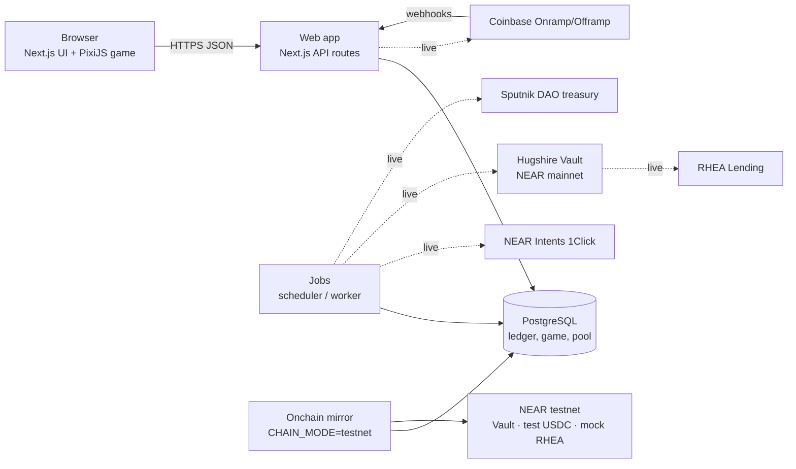

# Hugshire: system design, implementation and economy

*Where kindness takes shape.* This is the single reference for how Hugshire is built, how money and the game work, which parts are onchain, and what is still simulated or unfinished. Status as of November 2026.

**Live demo:** https://hugshire-production.up.railway.app (test mode).

**Repository:** github.com/kamping900-sys/hugshire.

---

## 1. What Hugshire is

Hugshire is a cozy town-building game funded by charitable lending yield.

- **Supporters deposit money.** It's lent out through the Hugshire Vault to RHEA (lending on NEAR) and earns variable interest. The deposit stays the supporter's.
- **The interest grows as Heart Fruit** on the supporter's Heart Tree. Fruit is sent to a cause's town, by hand or automatically.
- **Every cause has a shared town.** Players chop Wood in a mini-game and build the town together. Wood is virtual and never money.
- **An optional Community Heart Pool** turns received ad revenue into equal shares (golden fruit) that each supporter directs to a cause.
- **Organisations post real updates** on each town's Notice Board.

**The rule everything follows:** gameplay never changes how much real money is generated. Play only changes **when** earned interest is delivered and **which approved cause** receives it. Wood can never become money.

### Three separate economies

| Economy | What it is | Can become money? |
|---|---|---|
| Personal yield | a supporter's deposit → lending interest → Heart Fruit → causes | it *is* money (interest only; the principal stays the supporter's) |
| Community Heart Pool | received ad revenue → equal shares → golden fruit → causes | it *is* money (separate treasury, separate ledger accounts) |
| Construction | Wood from mini-games and auto workers → shared buildings | **never**: there are no money accounts for it at all |

---

## 2. The player journey

1. **Landing page** with an animated title and village road. The buttons are Start helping, How it works (an illustrated 6-chapter modal) and For organisations (an inquiry form).
2. **Sign-in** opens a modal on the same page with an email code. In test mode the code is filled in automatically.
3. **Onboarding wizard:**
   - Pick one of 8 animal helpers and name it.
   - Choose a home town (a cause).
   - Choose an amount ($10 / $25 / $50 / $100 / custom) and accept the risk notice.
   - Go through the test checkout. It shows the money route with partner logos: card → Coinbase Onramp → NEAR Intents → Hugshire Vault → RHEA → causes.
4. **Celebration:** "Payment successful!", then the money glows, evolves with a flash, becomes the helper ("Ta-da!") and drops into the centre of town.
5. **Arrival tutorial:** walk with WASD or the arrow keys, then a spotlight on the Heart Tree, a plot and the Notice Board. It can be skipped.
6. **Town (area map):**
   - Walk around; press E for the prompt in front of you.
   - Title board with cause info. HUD with the helper on one side and stats on the other (my deposit, donated, donates per day).
   - Bottom menu: World map, Heart Tree, Helper.
   - About 10 plots per town, each holding at most one building project at a time.
7. **Heart Tree** (large modal):
   - Left side: the tree with fruit you can tap.
   - Right side, three tabs:
     - **My interest:** pick fruit, then Send it, plus the auto-send daily switch (on by default).
     - **My deposit:** deposit, interest earned, being delivered and donated; Plant more and Withdraw; and, in onchain mode, the onchain card.
     - **Community gift:** golden fruit, sent by Auto delivery (the default) or Pick a town.
8. **Withdraw:** 25% / 50% / All or an amount, with the route back shown, then "Withdrawal on its way, arrives in 1–3 business days".
9. **Wood mini-game:**
   - A four-step guide, then a timing bar with Perfect (green) and Hit (yellow) zones.
   - 3 hearts, a combo multiplier and "ON FIRE".
   - Results with Watch an ad / Play again / Back to town.
10. **World map:** a side-scrolling road with every town. Drive the van, or tap a town to auto-drive to its gate, then press ↑ to enter. It opens at the town you came from.
11. **Notice Board:** organisation posts with photos, labelled "Reported by the organisation" until verified.
12. **Helpers:** one helper per cause. Players can switch helpers, rename them, or add one by planting for another cause.
13. **Music:** a soft background soundtrack, with a mute toggle.

---

## 3. Architecture

### Tech stack

| Layer | Choice |
|---|---|
| App | Next.js 16 (App Router), React 19, TypeScript, Tailwind CSS v4, Manrope font |
| Game | PixiJS v8 (one WebGL app per scene). Sound is synthesised with Web Audio |
| Data | PostgreSQL through Drizzle ORM. Locally, embedded PGlite. Migrations run on start |
| Validation | zod on every API input |
| Contracts | Rust, near-sdk 5.30: `contracts/vault`, plus `mock-ft` (test USDC) and `mock-rhea` |
| NEAR client | `@near-js/crypto`, `@near-js/transactions` and a small JSON-RPC client (`src/server/providers/near.ts`) |
| Tests | vitest (86 unit tests), Playwright (browser end to end), near-workspaces (contract sandbox) |
| Hosting | Railway (web service + PostgreSQL). Cloudflare R2 for uploads in production |

### Modes

| Mode | Setting | What happens |
|---|---|---|
| **Sandbox** (default, the live demo) | `HUGSHIRE_MODE=sandbox` | Labelled stand-in providers; the server's state machines simulate every money step. No money moves |
| **Onchain testnet** | `CHAIN_MODE=testnet` (with sandbox) | As sandbox, plus a mirror that turns deposits, donations, withdrawals and pool payouts into **real NEAR testnet transactions** with test USDC |
| **Live** | `HUGSHIRE_MODE=live` | Real providers on mainnet. It refuses to start without every credential, refuses dev sign-in, and requires `NEAR_NETWORK=mainnet`. **Not deployed** |

### Where the code lives

| Area | Path |
|---|---|
| Pages and API routes | `src/app/**` (31 pages, 41 API routes) |
| Game engines | `src/game/v4/TownGame.ts` (town), `RoadWorld.ts` (world map), `scenes.ts` (Wood mini-game), `rules.ts` (economy rules), `town.ts` (plots, blueprints) |
| UI | `src/components/{town,journey,landing,worldmap}` |
| Server services | `src/server/services/*`: deposits, yield, deliveries, payouts, withdrawals, reconcile, processor, live-steps, game, heartTree, towns, stories, pool, journey, chain-sync |
| Providers | `src/server/providers/{sandbox,live,near,treasury,ads}.ts` |
| Core (ledger, settings, audit, alerts) | `src/server/core.ts` |
| Jobs | `src/server/jobs.ts`; worker at `src/worker/index.ts`; in-process start in `src/instrumentation.ts` |
| Onchain testnet | `src/server/chain/testnet.ts`, `src/server/services/chain-sync.ts`, `src/app/api/chain` |
| Contracts | `contracts/{vault,mock-ft,mock-rhea,integration}` |
| Database schema and migrations | `src/server/db/schema.ts` (45 tables), `drizzle/` (0000–0014) |
| Trailer production | `trailer/` (separate project) |

---

## 4. Money system

### 4.1 Live route (designed for production)

**In:** card → **Coinbase Onramp** (USDC on Base, into the user's own Privy wallet) → **NEAR Intents 1Click** (Base → NEAR) → **Hugshire Vault** → **RHEA Lending** (`contract.main.burrow.near`) → interest → causes.

**Out:** RHEA → Vault (pays principal only to the owner) → 1Click (NEAR → Base) → **Coinbase Offramp** → the user's bank.

RHEA and 1Click run on mainnet only, and Coinbase has no testnet that delivers tokens. So the full route can't be tested end to end on testnet. See §7 for what does run onchain.

### 4.2 Deposit lifecycle

`created → onramp_pending → onramp_completed → bridging → bridged → vault_pending → supplied`. The side exits are `failed`, `refunded` and `manual_review`.

- Each step is a state machine transition with idempotency keys. Illegal transitions are refused.
- **In sandbox**, the test checkout runs the whole simulated route at once, so the player lands in town with an active deposit and helper.
- **When a deposit is supplied:** the ledger books the principal and the helper is created (one per cause).

### 4.3 Yield (interest)

- **Snapshots:** every 5 minutes the pool's value is observed and compared with the ledger. In sandbox, the observation is simulated from RHEA's live USDC rate.
- **Allocation:** each snapshot's yield is allocated pro rata by **principal × seconds held**. This is integer micro-USDC; remainders go to an unallocated account.
- **Settlement:** each allocation becomes eligible ("ripe") after a **1-hour settlement window**.
- **Fruit:** the Heart Tree shows ripe yield as 1–12 red fruits (roughly one per $0.05), split exactly. Yield that is still settling shows as buds.

### 4.4 Delivery (fruit → cause)

- **Manual:** pick fruit, choose a town, then Send. The client only caps the amount; the server takes exactly the ripe yield, locked oldest first.
- **Auto-send daily:** on by default for new players. A separate inactivity fallback (7 days without play) runs only after explicit authorisation. Inactivity alone never moves money.
- **Payouts:** deliveries become Heart Parcels (as small as $0.001). They are batched per cause and paid once a cause reaches **$1**, then submitted and confirmed.

### 4.5 Withdrawal lifecycle

`requested → pending_protocol_withdrawal → bridging → available_for_offramp → offramp_processing → completed`. The side exits are `failed` and `manual_review`.

The UI shows "on its way, 1–3 business days". The withdrawn amount stops earning straight away.

### 4.6 Ledger and safety controls

- **Double-entry ledger:** each business event writes exactly one journal, unique per environment, kind and reference. Money is stored as integer micro-USDC (`numeric(38,0)`), never floats.
- **Reconciliation:** every 10 minutes the ledger is compared with what the pool and chain report. Any mismatch raises an alert, and a pool deficit halts yield allocation.
- **Audit log:** every admin and money action is recorded.

---

## 5. The Hugshire Vault (NEAR contract)

`contracts/vault`: share-based, with user-authorised donations.

- **Accounting:**
  - Shares carry a virtual offset.
  - `value = shares × pool value`, `yield = value − principal`, `withdrawable = min(principal, value)`, so pool losses are shared.
- **Deposits:**
  - Made with `ft_transfer_call` (USDC only, minimum 1 USDC) and queued.
  - The keeper calls `process_deposits`, which reads RHEA, mints shares at a fair price, then **supplies the idle USDC to RHEA in the same transaction**.
- **Withdraw:** only the owner can call it, and it only pays the owner (`withdraw(amount)` takes the funds out of RHEA, then transfers them).
- **Donate:** `donate([{cause, amount}])` pays from the supporter's own yield to **approved causes only**, and records it per user and per cause.
- **Policy and grants:**
  - Supporters set allocations and a daily cap for session keys.
  - The keeper's `auto_deliver` is limited by the supporter's signed grant (minimum, maximum, interval, expiry).
- **Safety:**
  - The Vault is locked around each RHEA read and its callbacks.
  - **One operation per supporter per minute.**
  - Withdrawals can be paused for at most 72 hours, with a 24-hour cooldown.
  - Deposits start closed; there is a depositor allowlist until they're public.
  - Ownership changes in two steps.
  - Every payout has an id and a status.
- **Tests:** 42 unit tests and 7 NEAR-sandbox integration tests.
- **Status:** **not audited.** It is deployed to **testnet only** (§7).

---

## 6. Community Heart Pool

The monthly cycle:

`revenue_reported → revenue_finalized → budget_transferred → treasury_funded → snapshot_finalized → allocations_calculated → choosing → payouts_prepared → awaiting_approval → executed → reconciled`

- **Revenue:** only ad revenue marked as received counts; estimates never do. Simulated revenue is refused in live mode.
- **Charity share:** set by an admin and shown publicly. **It is currently not set (0%)**, so finalising a month is refused until it is.
- **Equal split:** `per_tree = floor((budget + carry_in) ÷ eligible)`, with the remainder carried forward. It doesn't depend on deposit size, Wood, games or ads.
- **Eligibility:**
  - an active account at least 30 days old
  - at least a $10 deposit held for the whole 30-day holding period
  - a one-person (uniqueness) attestation
- **Choosing:** supporters have 14 days to choose. Otherwise the default applies: the default cause, else the most recent choice, else the helper's home town, else the share is carried forward.
- **Treasury:** a Sputnik DAO v2 managed in Trezu. Hugshire only proposes, the council approves (2 approvals), and the payout executes. In sandbox there's a labelled stand-in DAO.
- **Audit:** the snapshot is published with pseudonyms and a sha256 hash. `/api/pool/cycles/[id]` recomputes the hash and lists every payout.
- **Ads:**
  - Optional, after a mini-game, with no reward for watching.
  - At most 1 every 3 minutes (15 s in sandbox) and 10 a day.
  - Real ads are disabled. In sandbox each simulated view adds a $0.01 golden allocation, labelled simulated.

---

## 7. Onchain mode on NEAR testnet (`CHAIN_MODE=testnet`)

### Deployed

| What | Account |
|---|---|
| Hugshire Vault | `vault.hugshire-demo-s5q1.testnet` (owner `hugshire-demo-s5q1.testnet`, keeper `keeper.hugshire-ops-s5q1.testnet`) |
| Test USDC (`mock-ft`, 6 decimals) | `usdc.hugshire-demo-s5q1.testnet` |
| Mock RHEA lending pool | `rhea.hugshire-demo-s5q1.testnet` |
| Cause wallets | `pawsbury.` / `inkwell-hollow.` / `fernhollow.` / `ladle-lane.hugshire-ops-s5q1.testnet` (approved in the Vault) |
| Community treasury | `p21fdb4c69f9a.hugshire-ops-s5q1.testnet` |
| Player wallets | `p<hash>.hugshire-ops-s5q1.testnet`, one per player, with keys derived from `CHAIN_WALLET_SECRET` |

### What runs onchain

A background loop (`chain-sync.ts`, every 8 s) mirrors game actions as real transactions:

| Game action | Onchain |
|---|---|
| Deposit supplied | test USDC minted to the player's wallet → `ft_transfer_call` into the **Vault** → keeper `process_deposits`, which mints shares and supplies the funds to mock RHEA |
| Interest | test USDC minted into mock RHEA, then `accrue(bps)` raises every supplier's balance. The amount is topped up to match the game's interest |
| Fruit delivery | the player's wallet calls `vault.donate`, so **USDC goes to the cause's wallet** |
| Withdrawal | the player's wallet calls `vault.withdraw`, so **USDC returns to the player's wallet** |
| Pool payout (executed) | the treasury receives the budget, then **transfers USDC to the cause's wallet** |

- **Recording:** every hash is stored in `chain_txs` and shown in **Heart Tree → My deposit → Onchain · NEAR testnet**, with explorer links.
- **Timing:** the game never waits for the chain. Transactions land about half a minute later, and the per-minute Vault limit simply retries.
- **History:** actions before `CHAIN_SINCE` aren't replayed, except for accounts listed in `CHAIN_BACKFILL_EMAILS`.

**Verified runs:**
- [deposit into the Vault](https://testnet.nearblocks.io/txns/7wXBF1es7kfm8FQyS5H3aBEnCAGdT78iU1nXfFnwVoTd)
- [donation to Fernhollow](https://testnet.nearblocks.io/txns/8dZDpPUM5XHG3z11zV6vYR9S8Z7iB3Sc6BqSYb6iWFbg)
- [withdrawal](https://testnet.nearblocks.io/txns/HK7HQutwetrJjbNY1gu6fWbDk61GYjL851bTZwWuTR4R)
- [pool payout to Pawsbury](https://testnet.nearblocks.io/txns/EBuY3mraEHzhteFTtfgLc29UMRvmLwbqBmqcaEzXoDAZ)

### Onchain or not, at a glance

| Step | Onchain? |
|---|---|
| Deposit into the Vault, supply to lending | ✅ testnet |
| Interest | ⚠️ mock RHEA, topped up to match the real mainnet rate used by the game |
| Donation to the cause's wallet | ✅ testnet |
| Withdrawal to the player's wallet | ✅ testnet |
| Pool payout to the cause's wallet | ✅ testnet (one treasury wallet, not a DAO vote) |
| Card payment (Coinbase Onramp) | ❌ simulated; no testnet exists |
| Bridge Base ↔ NEAR (NEAR Intents) | ❌ simulated; mainnet only (test USDC is minted instead) |
| Bank payout (Coinbase Offramp) | ❌ simulated |
| Real RHEA lending | ❌ mock on testnet; RHEA lending is mainnet only |
| Player wallet custody | ⚠️ the server holds the testnet keys for the demo. In production players sign with their own Privy wallets (UI not built) |
| Ad revenue, pool eligibility and allocations | ❌ worked out offchain; the snapshot is published with a hash |
| Wood, buildings, mini-games, fruit display | ❌ game data on the server, by design |

**All onchain amounts are test tokens with no value.** Railway runs this mode only once the `CHAIN_*` variables from `.data/chain/railway.env` are added.

---

## 8. Game economy (Wood and construction)

### 8.1 Wood mini-game

1. Walk to an unfinished building, press E, then **Chop Wood!**.
2. The server opens a session with a secret seed and reveals 5 attempts per round.
3. An indicator slides across a bar:
   - stop it in **green** for a Perfect (2×)
   - stop it in **yellow** for a Hit (1×)
   - anywhere else, or taking longer than the attempt's time limit, is a Miss and costs a heart
4. Difficulty rises with chops attempted: Easy, then Medium (from chop 9), Hard (from chop 21), Extreme (from chop 36). The zones shrink and move and the indicator speeds up. Zones never go below 12% (yellow) or 4% (green) of the bar.
5. The client sends only raw stop times. The server recomputes the bar, judges each stop, and commits the result to the building once.

### 8.2 Construction

- About 10 plots per town (small, medium and large). A blueprint must match the plot size, and roads always stay clear.
- A supporter can start **one** unfinished project at a time, but can help on any number. Each plot holds one open project.
- An unworked reservation expires after 24 hours. Once work has started, the building stays completable.
- **Stages:** empty → foundation → frame → nearly done → complete, with art for each stage.
- Every contribution is applied exactly once, capped at what the building still needs.

### 8.3 Auto workers

- Depositors' auto workers add Wood once per hour per supporter. They're idempotent, have no Perfect or combo bonus, and run in the server job, never on browser timers.
- They pause while the player has a game open, and stop when the deposit stops.

### 8.4 Anti-cheat

- **The server owns:** one open session per user, the resource choice and the seed, the timing windows, hearts, combo and rewards, the caps, and a single commit.
- **The server rejects:** rounds submitted faster than they could be played, replayed rounds, inhumanly consistent timing (flagged), and any score sent by the client.
- **The honest limit:** a browser can't prove a human pressed the keys. The stakes are capped, virtual Wood only.

---

## 9. All the numbers (current settings)

### Money

| Setting | Value |
|---|---|
| Deposit | minimum $5, maximum $2,500 (Coinbase's weekly card limit) |
| Interest | variable, from RHEA's live USDC rate (recently about 9.9–10.7% a year). Example: $100 earns roughly $0.027 a day |
| Yield snapshot | every 5 minutes |
| Settlement window | 1 hour before interest is ripe |
| Fruit | 1–12 per tree, roughly one per $0.05 of ripe interest |
| Heart Parcel | $0.001 minimum |
| Payout batch | per cause, once it reaches $1 |
| Auto-send | daily, on by default for new players |
| Inactivity fallback | 7 days, only after explicit authorisation |
| Vault limit | 1 operation per supporter per minute |
| Withdrawal pause | at most 72 hours, then a 24-hour cooldown |

### Community Heart Pool

| Setting | Value |
|---|---|
| Charity share of ad revenue | **not set (0%)**: an admin must set it before a month can be finalised |
| Eligibility | $10 minimum deposit held 30 days; account at least 30 days old; one-person attestation |
| Choice window | 14 days |
| Treasury approvals | 2 |
| Ads | at most 1 every 180 s (15 s in sandbox), 10 a day; production ads disabled |
| Simulated ad value (sandbox) | $0.01 a view |

### Wood (×50 scale)

| Setting | Value |
|---|---|
| Base Wood per Hit | deposit × 0.05 per $1 up to $1,000 ($10 gives 0.5, $100 gives 5, $1,000 gives 50); above $1,000, 50 × √(deposit ÷ $1,000) |
| Perfect / Hit | 2× / 1× |
| Combo | `min(1 + floor(streak ÷ 5) × 0.05, 1.5)` |
| Hearts | 3 |
| Session cap | 50,000 Wood |
| Daily cap | 500,000 Wood a day |
| Longest session | 10 minutes |
| Cooldown | off (admin setting `gameCooldownSeconds`) |
| Free play (no deposit) | 0.5 per Hit, up to 500 a day; free players can help but can't start buildings |
| Auto workers | base × 24 per hour (about 10× slower than playing) |

**Building costs:**

| Kind | Plot | Building | Wood |
|---|---|---|---|
| House | Small | Cozy Cottage | 30,000 |
| House | Small | Family House | 40,000 |
| Building | Medium | Bookshop | 200,000 |
| Building | Medium | Big Barn | 220,000 |
| Building | Large | School | 1,200,000 |
| Building | Large | Town Hall | 5,000,000 |

Scenery only (not buildable): Windmill, Gazebo, Lighthouse, Greenhouse, Clinic, Art Studio.

**Example:** with $100 deposited, a Perfect chop gives 10 Wood, or up to 15 with a full combo. A Cottage takes roughly 2,000–3,000 Perfect chops from one player, which is why towns are shared.

---

## 10. Data model (45 tables)

| Group | Tables |
|---|---|
| Accounts | `users`, `user_profiles`, `sessions`, `login_codes`, `identity_attestations` |
| Organisations and causes | `organizations`, `organization_members`, `organization_verifications`, `causes`, `cities`, `cause_updates` (Notice Board), `story_reports`, `org_inquiries` |
| Helpers and preferences | `helpers`, `helper_preferences` (home, active helper, auto-send), `support_positions` |
| Deposits and providers | `deposits`, `onramp_transactions`, `bridge_transactions`, `lending_positions`, `webhook_events` |
| Yield and delivery | `yield_snapshots`, `yield_allocations`, `deliveries`, `delivery_allocations`, `charity_payouts`, `withdrawals` |
| Ledger and operations | `ledger_journals`, `ledger_entries`, `audit_logs`, `admin_actions`, `system_alerts`, `platform_settings`, `job_runs` |
| Construction | `construction_projects`, `game_sessions`, `resource_contributions` |
| Community Pool | `pool_cycles`, `ad_revenue_reports`, `ad_views`, `pool_eligibility`, `pool_allocations`, `pool_payouts`, `treasury_proposals` |
| Onchain mirror | `chain_txs` (testnet transaction per game action) |

---

## 11. Background jobs

| Job | Every | Does |
|---|---|---|
| `process_deposits` | 5 s | moves deposits along the route |
| `process_withdrawals` | 10 s | moves withdrawals along the route back |
| `verify_vault_deposits` / `verify_vault_withdrawals` | 15 s | verifies user-signed Vault transactions (live) |
| `yield_snapshot` | 5 min | observes the pool and allocates yield |
| `auto_delivery` | 1 min | sends ripe fruit for supporters with auto-send on |
| `batch_payouts` / `submit_payouts` / `confirm_payouts` | 2 min / 30 s / 30 s | groups deliveries per cause and pays them |
| `reconcile` | 10 min | compares the ledger with the pool and chain |
| `pool_cycle` | 2 min | runs the Community Pool month |
| `auto_workers` | 10 min | adds auto-worker Wood (once per hour per supporter) |
| `expire_*`, `housekeeping` | 30 s – 1 h | closes stale checkouts, sessions and reservations; prunes job history |
| Onchain mirror (`chain-sync`) | 8 s, its own loop | testnet transactions for deposits, donations, withdrawals and pool payouts |

Jobs are claimed per time slot, so running two workers is safe. In sandbox they run inside the web process; in live mode they run in a separate worker.

---

## 12. API and pages

**API (41 routes):**
- **Sign-in:** `auth/dev/*`, `auth/privy`, `auth/logout`
- **Player:** `me`, `journey`, `preferences`, `helpers/[id]`
- **Money:** `deposits`, `deposits/[id]/sandbox-complete`, `withdrawals`, `deliveries`, `heart-tree`, `live` (user-signed steps)
- **Game:** `world`, `town/[slug]`, `town/[slug]/presence`, `construction`, `minigame/start`, `minigame/[id]`
- **Ads and pool:** `ads`, `pool`, `pool/choice`, `pool/attest`, `pool/cycles/[id]`
- **Causes and organisations:** `causes/[id]`, `causes/[id]/cover`, `stories/[id]/report`, `org/*`, `org-interest`
- **Admin:** `admin`, `admin/pool`, `admin/stories`
- **Other:** `webhooks/coinbase`, `chain` (onchain view), `health`, `dev/snapshot`

**Pages (31):**
- **Player:** landing `/`, `/worldmap`, `/worldmap/town/[slug]`, `/how-it-works`, `/explore`, `/portfolio`, `/deliveries`, `/helpers`, `/settings`, `/pool`, `/login`, `/start`, `/support/[slug]`, `/sandbox/checkout/[id]`
- **Organisation portal:** `/org/*`
- **Admin portal:** `/admin/*` (organisations, causes, transactions, payouts, pool, health)
- **Legacy:** `/old-landing`, `/worldmap/classic`

---

## 13. Security and safety

- **Separate accounting:** the three economies never mix, and Wood has no money accounts.
- **Money handling:** integer money, a double-entry ledger, every event happens once, state machines, and reconciliation with alerts.
- **Requests:** a same-origin check on every write, rate limits, zod validation and audit logs.
- **Live mode** refuses to start without its credentials, and test sign-in is impossible in live mode.
- **Contract:**
  - Principal can only return to its owner.
  - The keeper is limited by user grants and approved causes; a leaked keeper key can at worst send already-earned yield to an already-approved cause.
  - Pauses are capped, deposits start closed, and ownership changes in two steps.
- **Testnet keys** live only in env variables or gitignored files and were never committed. Player wallet keys are derived, not stored.
- **Not production-ready yet:**
  - the Vault isn't audited
  - no Content-Security-Policy
  - an in-process rate limiter
  - player presence is held in memory (one web instance only)
  - the operator key is in an env variable, not a key management service
  - legal review is pending (money transmission, securities, charitable fundraising, ad and pool wording)

---

## 14. Deployment

- **Railway (current):** one web service plus PostgreSQL.
  - **Build:** `npm ci && npm run build`. **Start:** `npx next start -p $PORT`. **Health check:** `/api/health`.
  - **Variables:** `HUGSHIRE_MODE=sandbox`, `DATABASE_URL`, `SESSION_SECRET`, `APP_URL`, `ADMIN_EMAILS`, `AUTH_PROVIDER=dev`, `HUGSHIRE_INPROCESS_WORKER=1`.
  - The sample towns were seeded once with `scripts/seed-sandbox.ts`.
- **Onchain demo:** add the `CHAIN_*` variables from `.data/chain/railway.env` and redeploy.
- **Live (future):** a separate project and database.
  - `HUGSHIRE_MODE=live` and `AUTH_PROVIDER=privy`.
  - Privy, Coinbase (CDP), NEAR Intents and NEAR keys; a paid RPC.
  - A separate worker service.
  - Deploy the audited Vault to mainnet, then run a team-only test.
  - Steps are in `docs/SETUP_GUIDE.md`.

---

## 15. Testing

| Suite | Result |
|---|---|
| App unit tests (vitest) | 86 passing |
| Browser end to end (Playwright) | 8 tests: the town flow and the critical money flow |
| Contract unit tests | 42 passing |
| Contract sandbox integration | 7 passing |
| Onchain testnet runs | the contract loop (`scripts/testnet-demo.ts`); an app deposit and withdrawal (`scripts/chain-e2e.cjs`); an app donation (`scripts/chain-e2e-donate.cjs`); a pool payout (`scripts/testnet-pool.ts`) |

---

## 16. What is simulated, unfinished or blocked

**Simulated in the demo:**
- Coinbase on- and off-ramp, the 1Click bridge and real RHEA lending
- ad revenue
- the DAO council vote
- in sandbox without chain mode, every money step

**Code still to build:**
- the Privy sign-in screen and signing prompts
- the live Vault keeper job
- reading balances live from the Vault in live mode
- shared presence (Redis or WebSockets)
- a Content-Security-Policy, key management and Sentry error tracking

**Blocked on accounts or decisions:**
- Coinbase KYB and keys, a Privy app, a NEAR Intents partner key, a paid RPC
- mainnet multisig and keeper accounts
- a Vault audit
- the Sputnik DAO in Trezu
- **the pool's charity share**, an ad network and a uniqueness provider
- legal review

**Strategy:** keep real money honest and auditable first, make the game rewarding without inventing money, and use community funding to give play a real charitable purpose.

---

## 17. Related docs

- `README.md`: the hackathon overview (problem, solution, impact, business model, onchain proof).
- `docs/BUSINESS_MODEL.md`: revenue streams, configured vs planned, illustrative unit economics.
- `docs/IMPACT_AND_SUSTAINABILITY.md`: impact dimensions and the measurement framework.
- `docs/RESEARCH_AND_EVIDENCE.md`: sourced research behind the problem statement.

- `docs/SETUP_GUIDE.md`: step-by-step setup (database, hosting, Privy, Coinbase, NEAR, 1Click, RHEA).
- `docs/ONCHAIN_TESTNET.md`: the onchain testnet mode in detail.
- `docs/VAULT_V2.md`: Vault design, invariants and the audit of v1.
- `docs/ARCHITECTURE.md`, `docs/FINANCIAL_MODEL.md` and `docs/SECURITY.md`: deeper dives.
- `docs/V4_GAMEPLAY_ECONOMY.md` and `docs/KNOWN_LIMITATIONS.md`.
- `trailer/README.md` and `trailer/out/*-notes.md`: how the trailer is produced.
