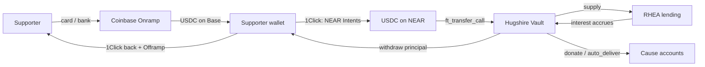
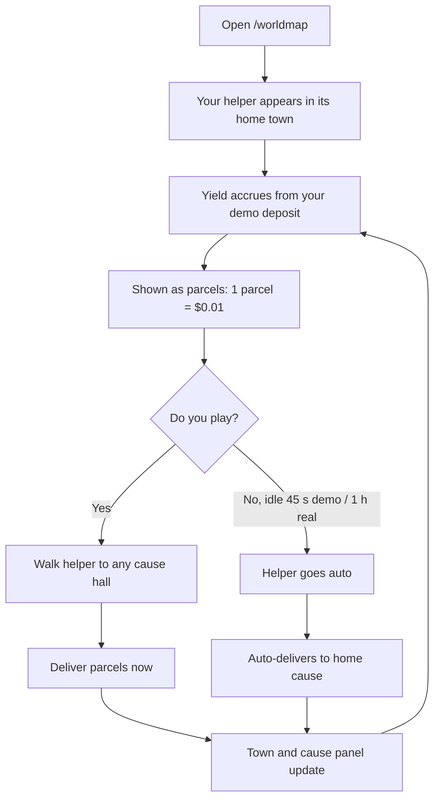

# Hugshire: project overview (2026-11-10)

Where kindness takes shape. This is the one-page map of the project:
- what is built;
- how the money moves;
- how the game works;
- how the game economy is designed.

Deeper detail lives in the other docs: ARCHITECTURE, FINANCIAL_MODEL, VAULT_V2, WORLD_ENGINE, SECURITY
and KNOWN_LIMITATIONS.

> **Status labels used below:** ✅ built and tested · 🟡 partly built · 📐 designed, not built ·
> ⛔ blocked on your accounts or approvals.

---

## 1. The idea in one paragraph

Supporters deposit money:
- The money is converted to USDC and moved to NEAR.
- It is lent out on RHEA, where it earns real interest (yield).
- The **principal stays the supporter's** and can be withdrawn.
- The **yield goes to charity causes** the supporter has chosen.

Every supporter gets an animal helper in a cozy 2D town (one town per cause). The game makes giving
visible and fun. **It never creates money**: the amount of yield depends only on how much is
deposited, for how long, and RHEA's interest rate. Play only affects **when** yield is delivered and
**which allowed cause** receives it.

---

## 2. What is implemented

### 2.1 Platform (Next.js app)

| Area | Status | Notes |
|---|---|---|
| Sandbox mode (fake providers, full flow end to end) | ✅ | Default locally. Clearly labelled. |
| Live mode (real providers) | 🟡 ⛔ | Refuses to start without credentials. |
| Double-entry ledger, bigint micro-USDC (no floats) | ✅ | `src/server/core.ts`, 31 tables |
| Deposits, yield, deliveries, payouts, withdrawals, reconciliation | ✅ | `src/server/services/*`, background worker |
| Auto mode (deliver after 1 h idle) | ✅ | Server-side job |
| Supporter pages: portfolio, helpers, deliveries, city, explore, settings | ✅ | |
| Organiser portal (`/org`) | ✅ | Profile, KYB status, payouts |
| Admin portal (`/admin`) | ✅ | Settings, alerts, reconciliation, audit log |
| Coinbase Onramp (session token + signed webhook) | 🟡 ⛔ | Code done; needs KYB and keys |
| NEAR Intents 1Click (Base ⇄ NEAR) | 🟡 | Quote and status verified read-only; return leg not orchestrated |
| Privy wallets / sign-in | 🟡 ⛔ | Server token check done; client UI not built (dependency conflict) |
| Tests | ✅ | 56 app unit tests, 5 browser end-to-end flows |

### 2.2 Vault v2 smart contract (NEAR, `contracts/vault`)

| Feature | Status |
|---|---|
| Share accounting (value per share, yield = value − principal) | ✅ |
| Principal-only withdrawal, losses shared fairly | ✅ |
| Supporter-chosen causes (`set_policy`), donations (`donate`) | ✅ |
| Session key: can donate only to the policy's causes, under a daily cap | ✅ |
| Keeper `auto_deliver`, bounded by the user's `AutoGrant` (min, max, interval, expiry) | ✅ |
| Payout records with states (Pending / Completed / Partial / Failed / Stale) | ✅ |
| Safety: locks, deposits closed by default, withdrawal pause max 72 h, two-step ownership | ✅ |
| 42 unit tests + 7 NEAR sandbox integration tests | ✅ |
| Deployed / audited | ❌ Not yet, on purpose |
| App reading balances from the vault | 🟡 Partly migrated |

### 2.3 World map game (`/worldmap`)

| Feature | Status |
|---|---|
| Fullscreen, endless, generated grid world (districts, roads, rivers, parks) | ✅ |
| Fast rendering: tile streaming, caches, zoomed-out thumbnails, sprite pooling | ✅ |
| 177 hand-made sprites (buildings, houses, props, ground) + 8 mascots with 4-frame walk cycles | ✅ |
| One controllable helper (click or keys to move), others wander and work | ✅ |
| Cause halls, parcels, manual delivery, auto delivery after idle | ✅ (demo data) |
| "Move support" truck between causes | ✅ (demo data) |
| Minimap, fast travel, overview zoom | ✅ |
| Connected to real balances | ❌ Demo data only |
| Hugs / Sparks economy, community building, mini-games | 📐 Designed (section 6) |

---

## 3. System flow: how the money moves

Step by step:

1. **Deposit.** The supporter pays with Coinbase Onramp and receives USDC on Base in their own
   wallet.
2. **Bridge.** NEAR Intents 1Click swaps Base USDC to NEAR USDC. A 10 USDC test quote returned
   9.998 USDC in about 35 s.
3. **Into the vault.** The supporter sends USDC to the Vault and receives **shares**. New deposits
   are queued, then priced against a fresh RHEA balance (`process_deposits`).
4. **Earning.** The Vault supplies idle USDC to RHEA (about 9% APR when checked). The value per
   share grows as interest accrues.
5. **Yield.** `yield = current value of your shares − your principal`. Only this part can go to
   charity.
6. **Delivery to causes**, in either of two ways:
   - **Manual**: the supporter, or their session key while playing, calls `donate`, only to causes
     in their policy.
   - **Auto**: after the supporter has been idle for long enough, the keeper calls `auto_deliver`.
     It is limited by the grant the supporter signed: minimum and maximum amounts, interval and
     expiry.
7. **Payouts.** The Vault withdraws from RHEA and transfers to the cause. Each payout gets an id
   and a status, plus an on-chain event, so it can be checked.
8. **Withdraw.** The supporter can withdraw principal at any time: `min(principal, value)`, which
   is less only if RHEA suffered losses.

**Accounting rules.**
- Money is always stored as integers in micro-USDC.
- Every movement is a balanced journal entry.
- Each journal is unique per event, so replaying an event can't double count.
- Reconciliation compares the ledger with the on-chain balances and raises alerts on any mismatch.

---

## 4. Game flow: how the world map works today (demo)

- **Yield is automatic.** It accrues from the deposit whether you play or not. The demo speeds time
  up 6,000× so you can see it (labelled in the UI).
- **Parcels are a picture of yield already earned**, not something the game creates.
- **Manual delivery:** walk your helper to a cause hall and deliver.
- **Auto delivery:** helpers you aren't controlling deliver to their home cause by themselves. Your
  own helper switches to auto after 45 s idle in the demo, 1 hour in the real app.
- **Move support:** the truck moves your support to another cause.
- **Other helpers** chop wood, mine and carry crates around town. This is purely visual.

**Known difference.** In the demo you can deliver to any cause. On the real vault, a session key can
deliver only to the causes in your policy, and this is enforced by the contract.

> **V4 update (2026-11-11):**
> - The overworld now uses real towns. Each one opens a detailed shared town.
> - The fixed $0.01 parcels were replaced by the Heart Tree (exact fruit values).
> - The idle fallback is now 7 days and only applies after explicit authorisation.
> - Building is done with Wood and Stone through two mini-games.
>
> See docs/V4_GAMEPLAY_ECONOMY.md.

---

## 5. The core rule (from the original brief)

> Gameplay must never change the amount of real yield.

- No play-to-earn, no money for skill, no interest boost from active play.
- Play changes **timing** (deliver now, or wait for auto) and **destination** (among allowed
  causes).
- A tradable $HUGS token with buybacks was considered and **rejected**, for three reasons:
  - The buyback would pay players with charity money.
  - It is likely a security.
  - It risks misrepresenting the donation.

---

## 6. Game economy design: SUPERSEDED

> **Retired on 2026-11-11.** The Hugs/Sparks design below was never built. It was replaced by the V4
> specification, which is implemented: Wood and Stone construction, Wood and Stone rhythm mini-games,
> the Heart Tree, and the Community Heart Pool. See **docs/V4_GAMEPLAY_ECONOMY.md**. This section is
> kept for history only.

### (historical) Game economy design 📐

The aim: playing should *feel* like you earn more and really help, and the town should feel built
by the whole community, while every number stays true.

### 6.1 Two currencies

| | **Hugs** 💛 | **Sparks** ✨ |
|---|---|---|
| What it is | Real yield your deposit has earned (1 Hug = $0.01) | Points from playing mini-games |
| Source | Only your deposit (RHEA interest) | Only playing |
| Changed by play? | **Never** | Yes, that is its purpose |
| Tradable? | No: it is delivered to causes | No: not a token, no cash value |
| Used for | Delivering to causes and supplying town **materials** | Town **labour**, cosmetics, badges |

### 6.2 Materials plus labour: the town can't look richer than the money behind it

Every community building needs both:
- **Materials 🧱**, from Hugs actually delivered to that cause. These decide **how much** the town
  can grow.
- **Labour 🔨**, from Sparks. This decides **how fast and how well** buildings get finished.

For example, a bakery might cost "$50 delivered + 2,000 Sparks". If only $3 has been delivered,
it stays at its foundation however much people play.

| Real yield | Play | Town looks |
|---|---|---|
| High | High | Big, beautifully finished |
| High | Low | Big but with scaffolding ("help finish it!") |
| Low | High | Small but polished, lots of cosmetics |
| Low | Low | Small and quiet |

### 6.3 Limits against $1 farming

- **Daily Sparks cap** scales with your own delivered Hugs, plus a small base so newcomers can
  still play.
- **Labour beyond the materials** goes only into cosmetics: your helper's outfit and your own plot.
- **Each building shows its real cost**, for example "Funded by $50.12 real yield from 84
  supporters".
- **Be honest about small deposits.** $1 at about 9% APR is about 9 Hugs a year, and the game
  shows that truthfully.

### 6.4 Why playing still feels better than idling

| | Idle (background) | Playing |
|---|---|---|
| Hugs given | Same, auto after 1 h | Same, delivered now, to the cause you choose |
| Sparks / town labour | None | Yes |
| Name on bricks, streaks, badges | None | Yes |
| Sponsor matching | No | Yes |

**The sponsor match pool is the only way play adds real money**, and the money comes from
sponsors, not the game. For example: "Acme matches up to $2,000 this month for deliveries made by
playing." The match is capped per user, relative to that user's own Hugs.

### 6.5 Community town

- One shared town per cause, built by everyone.
- **Real milestones** funded by Hugs, linked to real impact the charity reports, for example
  "$500 delivered → shelter roof".
- **Construction progress** at the town hall, for example "Bakery: 3,200 / 5,000 bricks".
- **Live presence:** see other players' helpers, and a feed like "Mina's fox delivered 40 Hugs".
- **Names in the world:** bricks, benches and a contributors' wall.
- **Events:** "Barn raising weekend" with sponsor matching and double Sparks.
- **Seasons:** each season builds a new district, and old ones stay as community history.

### 6.6 Mini-games (each one ends by delivering Hugs and earning Sparks)

- Parcel sorting at the post office (rhythm or match).
- Fishing for Hugs at the river.
- Crane stacking bricks on the community building.
- Garden tending for town decorations.

### 6.7 Optional later: advance delivery

A sponsor-funded reserve pays the charity now, against your future yield, and your future yield
pays it back.
- The advance is capped, for example at 30 days of projected yield.
- That part of your principal is locked until repaid.
- It needs contract changes and an audit, so it is not in the first version.

### 6.8 Wording rules

- ✅ "Play to build the town and unlock sponsor matches."
- ✅ "Your deposit earned 120 Hugs. Deliver them now!"
- ❌ "Play to earn more yield."

---

## 7. What is left (summary)

1. **Your accounts:** Coinbase KYB and keys, a Privy app, a NEAR operator account and gas plan,
   and a legal review of the deposit terms.
2. **Vault:** audit, a small-value mainnet test (VAULT_V2 §8), the keeper job, and reading
   balances from the vault in the app.
3. **Privy client:** sign-in UI and the three signing prompts.
4. **Game:** connect the world map to real balances; build Hugs and Sparks, community building and
   mini-games (section 6); optionally restyle the art.
5. **Hardening:** Content-Security-Policy, shared rate limiting, alert push, KMS for the operator
   key.

See `todo.md` for the working checklist and `docs/KNOWN_LIMITATIONS.md` for the full list.
